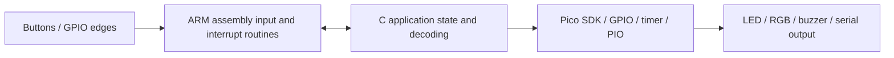

# Microprocessor Project — Raspberry Pi Pico

C and ARM assembly coursework for **CSU23021**, built on the Raspberry Pi Pico's RP2040 microcontroller. The objective is to develop low-level embedded programming skills through GPIO, interrupts, timers, programmable I/O and peripheral feedback.

The main applications are an interrupt-driven LED controller and a button-operated Morse-code learning game. The repository also contains supporting labs and the course's starter examples.

## My role and contributions

I implemented application logic in **C and ARM Cortex-M0+ assembly**, extending the supplied course templates:

- **Assignment 1:** timer-alarm scheduling, interrupt handlers, button-controlled blinking and RGB feedback.
- **Assignment 2:** button press/release timing and debouncing, dot/dash capture, Morse decoding, letter and sequence timing, and a four-level game with hints, lives, RGB and buzzer feedback.
- **Labs:** C/assembly exercises covering interrupts, multicore and floating-point work, and ADC temperature-to-colour output, with associated build configuration and recorded results.

Examples of my implementation commits are [7f12205](https://github.com/Npola1/MicroProcessorsProject/commit/7f12205), [fa8b9a5](https://github.com/Npola1/MicroProcessorsProject/commit/fa8b9a5) and [1375384](https://github.com/Npola1/MicroProcessorsProject/commit/1375384). The original course template and example code remain credited in the history.

## System architecture



Each assignment is a separate firmware image; there is no operating system or backend service. CMake builds the C and assembly sources against the Pico SDK and generates firmware outputs.

| Location | Purpose |
|---|---|
| [assignments/assign01/](assignments/assign01/) | GPIO20/21/22 button inputs, GPIO25 LED and GPIO28 RGB output |
| [assignments/assign02/](assignments/assign02/) | GPIO21 Morse button, GPIO20 buzzer, GPIO28 RGB and GPIO25 LED |
| [labs/](labs/) | Lab exercises and individual lab instructions |
| [examples/](examples/) | Supplied reference applications |

## How to run

Use an **RP2040 Raspberry Pi Pico** with a MAKER-PI-PICO-style peripheral setup or equivalent wiring. Install Git, CMake, Python 3, the Arm GNU embedded toolchain (`arm-none-eabi-gcc`) and a native build tool. Install the [Pico C/C++ SDK](https://www.raspberrypi.com/documentation/microcontrollers/c_sdk.html) and initialise its submodules.

```bash
git clone https://github.com/Npola1/MicroProcessorsProject.git
cd MicroProcessorsProject
cmake -S . -B build -DPICO_BOARD=pico -DPICO_SDK_PATH=/absolute/path/to/pico-sdk
cmake --build build --target assign01 assign02 --parallel
```

Replace the SDK path with your local installation. To use Ninja, add `-G Ninja` when configuring. Build a particular lab with, for example, `cmake --build build --target lab11`.

1. Wire the peripherals for the chosen assignment; the two assignments use different button/buzzer pin assignments.
2. Hold **BOOTSEL** while connecting the Pico over USB.
3. Copy `build/assignments/assign01/assign01.uf2` or `build/assignments/assign02/assign02.uf2` onto the `RPI-RP2` drive. Run one image at a time.
4. For the Morse game, a short press on GPIO21 enters a dot and a press of at least **250 ms** enters a dash. A one-second gap completes a letter; a two-second gap completes the sequence. The game starts automatically.

Assignment 1 enables USB serial output. Assignment 2 currently uses the SDK's default UART serial configuration; use a suitable UART monitor for its text prompts, or enable USB stdio for that target and rebuild. The root `wokwi.toml` points to **lab05**, so it is not a ready-made simulation of either assignment. Update the diagram and firmware paths for any simulation you create.

The checked-in VS Code configuration contains machine-specific tool paths; update those for your installation or use the CLI above. Build targets, pins and timing constants were checked against the source. Firmware execution on physical hardware was not verified during this documentation update.
